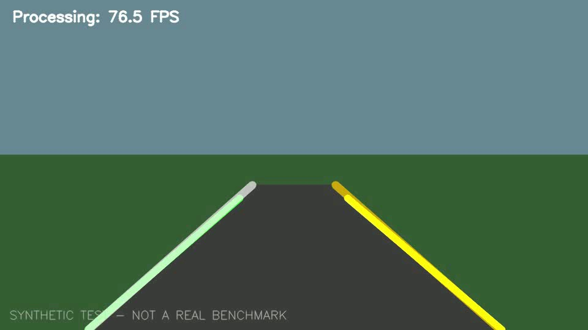

# Road Marking Detection — YOLO11n + OpenCV

> Computer Vision / Machine Learning engineering portfolio | Python · PyTorch · Ultralytics · OpenCV

This repository explores **road marking object detection** through a classical computer-vision baseline and a fine-tuned **YOLO11n** detector. It records the dataset preparation, training configuration, reproducible validation, and failure analysis rather than presenting a model demo alone.

**Scope:** The YOLO model predicts rectangular regions for one class, `road_line`. **It does not estimate full lane centerlines, left/right lane boundaries, or steering decisions.** A lane-segmentation project (U-Net / lane annotations) is a separate future workstream; **YOLO V2 here means a second fine-tuning experiment, not that U-Net project.**

## Project status

| Experiment | Purpose | Status |
|---|---|---|
| Classical OpenCV | Edge + Hough-based synthetic lane-line baseline | Implemented; smoke-tested only |
| YOLO V1 | Fine-tune pretrained YOLO11n on `road_line` boxes | Trained + validation evaluated |
| YOLO V2 | Continue fine-tuning with adjusted resolution/augmentation | **Planned / metrics not yet supplied** |

## YOLO V1 results

Metrics reported by the completed training log (10 validation images, 53 annotated boxes; **not** independent test results):

| Metric | YOLO V1 |
|---|---:|
| Precision | **0.741** |
| Recall | **0.321** |
| mAP@0.50 | **0.345** |
| mAP@0.50:0.95 | **0.219** |

Training: YOLO11n, pretrained initialization, 30 epochs, `imgsz=416`, `batch=1`, AdamW (auto-selected), NVIDIA GeForce MX450 2 GB. Ultralytics disabled automatic mixed precision after its numerical checks failed. Original training time ~4.68 minutes on that laptop. A **single prediction log** reported ~21.4 ms model inference per image; this is not end-to-end video FPS.

**Observed failure cases:** low recall on continuous markings, incomplete dashed-line detections, and occasional large false-positive regions in sky/non-road areas. More examples and cautions: [Evaluation](docs/evaluation.md).

## Example OpenCV baseline (synthetic smoke test)



*Generated synthetic scene, not real-world validation. Source-data sample images are not redistributed here pending dataset usage-rights confirmation.*

## Repository layout

```text
src/
  lane_detector.py        # OpenCV line extraction
  run.py                  # OpenCV demo on video
  train_yolo.py           # Re-train a YOLO11n baseline (optional)
  predict_yolo.py         # Inference with a selected checkpoint
prepare_yolo.py          # Pascal VOC XML ZIP -> YOLO labels + EXIF handling
generate_sample.py       # Synthetic road-video generator
tests/                   # Unit tests, including CLI/evaluation tests
scripts/evaluate_models.py
configs/                  # Optional local config, do not commit machine paths
models/yolo_v1/best.pt    # Copy selected local checkpoint (if redistribution permitted)
models/yolo_v2/best.pt    # Optional, only after V2 validation
assets/                   # Publicly shareable demos only
docs/                     # Architecture / dataset / training / evaluation / GitHub
```

## Quick start (Windows PowerShell)

Requires Python 3.11, your trained `best.pt`, and a compatible PyTorch install. Model weights and dataset are **not downloaded automatically**.

```powershell
cd D:\Projects\lane-line-detection-v1
py -3.11 -m venv .venv
.\.venv\Scripts\Activate.ps1
# Install a CUDA-enabled PyTorch build compatible with your driver from pytorch.org first.
python -m pip install -r requirements.txt
python -m unittest discover -s tests -v
python -c "import torch; print(torch.cuda.is_available())"
```

Place your original V1 checkpoint at `models/yolo_v1/best.pt` (or use `--weights` with its real path). Copy files into a local, Git-ignored input directory:

```powershell
New-Item -ItemType Directory -Path data\external_test -Force
# Add JPG/PNG photos of roads to data\external_test before running.
python -m src.predict_yolo --source data/external_test --device 0
explorer .\runs\detect\road_line_demo
```

For a sample OpenCV baseline:

```powershell
python generate_sample.py
python -m src.run --input data/sample_road.mp4 --output outputs/lane_overlay.mp4
```

For CPU-only inference, pass `--device cpu`.

## Training and validation

Your original image ZIP and XML annotations must be acquired separately and used lawfully:

```powershell
python prepare_yolo.py --zip "$env:USERPROFILE\Downloads\archive.zip" --out yolo_road_line
python -m src.train_yolo --data yolo_road_line/data.yaml --device 0
```

To compare the existing V1 checkpoint and a future V2 checkpoint using **identical** validation settings, reuse your original dataset in `D:\Projects\lane-line-detection` without copying hundreds of megabytes into V1:

```powershell
$data = "D:\Projects\lane-line-detection\yolo_road_line\data.yaml"
python scripts/evaluate_models.py --data $data --imgsz 512 --device 0
# Once V2 exists:
python scripts/evaluate_models.py --data $data --imgsz 512 --device 0 --v2 models/yolo_v2/best.pt
```

If you converted the dataset within the V1 repo instead, `--data yolo_road_line/data.yaml` is also valid.

This writes machine-readable metrics and a Markdown comparison to `reviews/comparison/`, which is ignored by Git until explicitly curated. See [Training](docs/training.md).

## Documentation

- [System architecture](docs/architecture.md)
- [Dataset and data quality](docs/dataset.md)
- [Training and reproducibility](docs/training.md)
- [Metrics and failure analysis](docs/evaluation.md)
- [Experiment log (V1 vs V2)](docs/experiments.md)
- [GitHub publication checklist](docs/git-workflow.md)

## Limitations and safety

Only 50 annotated images were available for this exploratory work, split 40/10; the validation set is too small for robust generalization claims. Bounding boxes are **not** continuous lane geometry. **This is a research and learning demonstration, not a safety-certified system for vehicles.** Check the license of Ultralytics, pretrained weights, and the source dataset before releasing copied weights or original photos. No dataset or personal recordings are bundled.
